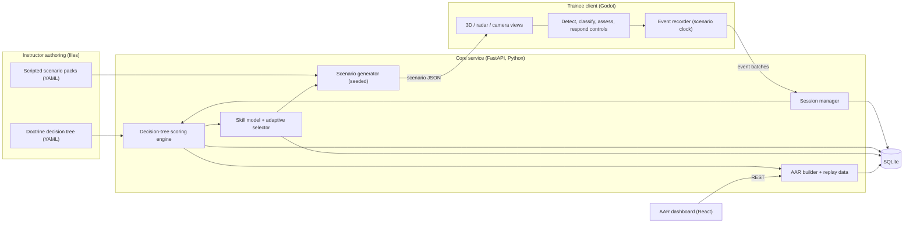
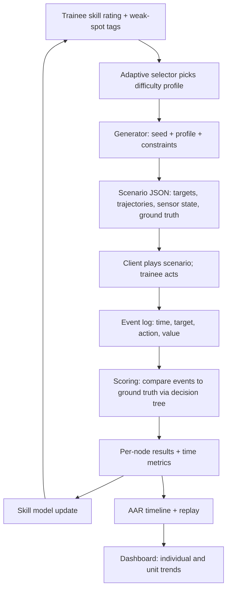
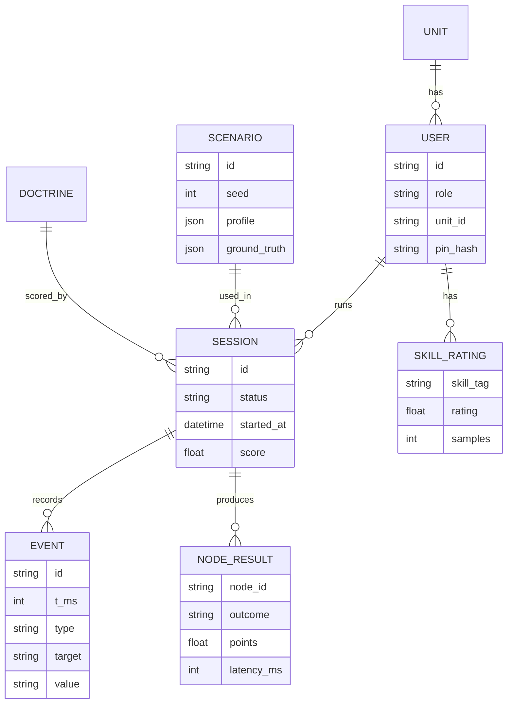
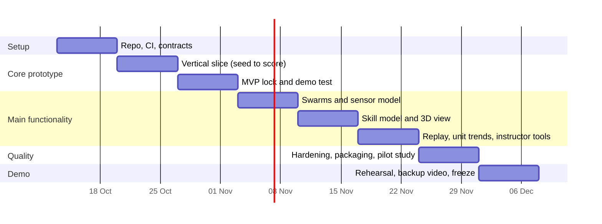

# SIH 26247 Execution Blueprint

Oct 12, 2026 · @Sudhanshu

## 0. Executive summary and assumptions

Build a seeded, offline desktop simulator in which the trainee detects, classifies and decides on drone and swarm threats under degraded sensors, then gets scored against an instructor-editable decision tree and a replayable after-action review (AAR). This is the recommended "Approach B" in section 3. Keep a simple 2D radar-and-camera console as the guaranteed fallback inside the same codebase.

**Three findings that shape everything else**

1. **A public repository already targets this exact problem statement.** [aaryan2203/Drone-Counter-Drone-Threat-Simulation-Trainer](https://github.com/aaryan2203/Drone-Counter-Drone-Threat-Simulation-Trainer) (PS ID 26247) shows YOLOv8, ByteTrack, FastAPI, SQLite, Unity and Next.js, with a fixed 30/30/30/10 score formula. At the time I opened it, it had 5 commits and 0 stars. Never claim your idea is completely novel; compete on depth, honesty and demo quality instead.
2. **The trainee, not a vision model, must do the detecting.** The statement asks for scoring of the person's detection time, classification accuracy and engagement decisions. Running YOLO on synthetic frames tests a model, not a soldier. Put AI where it improves training: adaptive difficulty, weakness-targeted scenario selection and procedural generation.
3. **Doctrine must be data, not code.** Rules of engagement (ROE) and classification criteria differ by unit and are sensitive. Ship the platform with generic, open-source threat classes and let the Defence Services Staff College (DSSC) supply its own decision trees as editable files.

**Research questions this document answers**

- What do existing counter-drone trainers do, and what do they leave unaddressed? (section 2)
- Which open datasets and components can we reuse legally? (section 2)
- What is the smallest system that satisfies all four expected outcomes? (sections 3 and 4)
- Where does AI/ML genuinely beat a simple rule? (section 5)
- How do we prove it works without inventing results? (sections 8 and 10)

**Assumptions I made (please correct any that are wrong)**

| Item | Assumption | Why it matters |
| --- | --- | --- |
| Team | 5 or 6 students: 1 sim/3D, 1 backend, 1 frontend/dashboard, 1 scenario/AI, 1 QA + presentation | Task split in section 7 |
| Time to finale | About 8 weeks of build, then a 36-hour finale | Scope and milestones |
| Hardware at finale | One mid-range Windows laptop, no GPU guaranteed, no internet | Offline-first design |
| VR | Desirable, not mandatory; desktop must stand alone | Statement says "desktop or VR-capable" |
| Doctrine | No classified TTPs; only generic open-source classes and a sample decision tree | Safety and data handling |
| Judging | Official SIH 2026 criteria not found; I label general jury expectations separately | Section 9 |

**Open questions for you:** exact team skills (Godot, Unity or web?), the real finale date, whether your mentor can get a sample decision tree from DSSC, and whether VR hardware will be available on the day. The SIH 2026 launch date of August 21, 2026 comes from a secondary blog ([reskilll](https://reskilll.com/blogs/wp-json/wp/v2/posts/236)); confirm all dates on [sih.gov.in](https://sih.gov.in/).

## 1. The problem, users and requirements

Soldiers need many realistic repetitions at recognising and responding to small drones and swarms, but live drills are costly, weather-dependent and cannot scale. The need is real and growing: the Indian Army's "Eagle in the Arm" initiative aims to make drone handling a standard soldier skill, with drone centres at the Indian Military Academy, Infantry School Mhow and Officers Training Academy Chennai ([Tribune](https://www.tribuneindia.com/news/india/army-rolls-out-initiative-to-make-all-soldiers-drone-ready)). Training volume is the bottleneck, not awareness.

**In plain words:** a trainee sits at a laptop (or in a headset), sees a sensor picture of a changing airspace, and must spot threats, label them, and choose a response. The system scores how fast and how correctly, explains mistakes, and serves the next scenario at the right difficulty.

**Root causes of the gap (from the statement, plus inference)**

- Classroom teaching gives knowledge but no time pressure or ambiguity.
- Live drills give realism but few repetitions per person, and depend on weather, range time and cost.
- Existing commercial simulators exist (section 2) but are proprietary and often tied to specific hardware or weapon replicas. This is my inference from vendor pages, not a verified market survey.
- Scoring is usually instructor judgement, which is hard to compare across sessions and units.

**Users and what they need**

| User | Real need | Feature that serves it |
| --- | --- | --- |
| Trainee (junior leader, air-defence or infantry soldier) | Realistic practice, fast feedback, fair scoring | Sensor console, timed decisions, instant debrief |
| Instructor | Author scenarios, set doctrine, see who is weak at what | Scenario editor, decision-tree files, class dashboard |
| Unit commander / training officer | Unit readiness trend over weeks | Unit-level AAR and trend charts |
| DSSC / MoD evaluators | Evidence that training improves performance | Exportable reports, repeatable seeded scenarios |

**Requirements extracted from the statement**

| ID | Requirement | Type |
| --- | --- | --- |
| R1 | Desktop or VR-capable simulator | Explicit |
| R2 | Scripted and procedurally generated scenarios | Explicit |
| R3 | Day/night, degraded sensors, urban/rural, single drone and swarm | Explicit |
| R4 | Decision-tree scoring on detection time, classification accuracy, engagement decisions | Explicit |
| R5 | AAR dashboard, individual and unit, across repeated sessions | Explicit |
| R6 | Adjustable difficulty and randomisation to prevent rote learning | Explicit |
| R7 | Unit-level use with minimal specialised hardware | Explicit |
| R8 | Works offline on one laptop; no cloud dependency | Implicit (defence setting, no assumed internet) |
| R9 | Doctrine and ROE editable by instructors, not hard-coded | Implicit |
| R10 | Identical scenario reproducible from a seed, for fair comparison | Implicit (needed to compare people) |
| R11 | Role-based access and local data protection | Implicit |
| R12 | Strictly training: no real weapon or targeting interface | Implicit (safety and acceptability) |

**Non-functional constraints:** 30 frames per second on an integrated-graphics laptop for the desktop mode, session start in under 30 seconds, all data stored locally, installable by copying a folder.

**Hardest technical challenges**

1. Making classification genuinely ambiguous (drone vs bird vs balloon vs friendly aircraft) without a licensed radar or imagery corpus.
2. A believable sensor model for degradation (night, weather, clutter, jamming-like dropouts) that is simple enough to test.
3. Scoring that is fair when different seeds have different difficulty.
4. Keeping the swarm behaviour credible and performant on weak hardware.
5. Showing evidence that training transfers, which a hackathon cannot prove; we can only show measurable in-sim improvement.

**Representative use cases**

- A unit trainer runs a 20-minute block at night with a thermal-style display degraded by haze; five soldiers each get the same seed and are compared.
- A trainee who keeps misclassifying birds as drones is automatically served more bird-clutter scenarios.
- A commander sees that the unit's average time to first detection fell across four weeks but "hold fire" decisions near friendly aircraft are still weak.

## 2. Existing solutions, data and reusable parts

Counter-drone training simulators already exist, mostly as proprietary VR or weapon-replica systems, so the opening is a free, hardware-light, doctrine-agnostic trainer with transparent scoring and unit-level analytics. That gap is my inference from the pages below; no source states it directly, so validate it with your mentor.

**Existing training products and projects**

| Name | What it does (per its own page) | Tech | Relevance to us |
| --- | --- | --- | --- |
| [Operator XR Interceptor](https://thedefensepost.com/2026/04/15/virtual-counter-drone-training/) | VR detect, identify, track, defeat training; armed FPV, ISR and swarm threat profiles; kinetic and non-kinetic options with electronic-warfare effects | VR (details not published) | Closest commercial analogue; proprietary, price not published |
| [Quantum3D Anti-Drone Shotgun Simulator](https://quantum3d.com/anti-drone-shotgun-simulator/) | Repeatable kinetic drone-defence practice without live fire; scalable to armories and mobile ranges | Weapon-based simulator | Marksmanship, not recognition or decisions |
| [Southern Federal University anti-drone simulator](https://thedefensepost.com/2025/08/06/russia-anti-drone-simulator/) | Student-built Unreal Engine simulator with radio-signal and GPS-obstruction effects and weapon models | Unreal Engine | Shows a student team can build this; weapon-centric |
| [StratOS Simulator](https://stratos.software/) | Tactical drone simulator with digital drone twins, EW training and synthetic data (vendor claims) | Not published | Operator-side training; claims unverified |
| [SKIFTECH Drop-Drone Trainer](https://skiftech.net/en/drone-with-a-payload-release-simulation-system) | Real drone drops training grenade simulators on soldiers wearing radio-triggered kits | Physical hardware | Live-hybrid; needs a drone and kits, the opposite of our brief |
| [US Army REACT](https://www.armytimes.com/news/your-army/2024/10/24/soldiers-in-army-basic-training-now-knocking-down-drones/) | Generates randomised drone or rocket attack information to drill an operations centre | Software (details not published) | Supports randomised-scenario value; ops-centre focus |
| [Drone Wars 3D (ITU thesis)](https://polen.itu.edu.tr/items/209a805a-f66a-4f2d-b968-c9c4f7b3043c/full) | Unity simulation comparing defences and swarm formations | Unity | Research on tactics, no trainee scoring or AAR |
| [aaryan2203 repository](https://github.com/aaryan2203/Drone-Counter-Drone-Threat-Simulation-Trainer) | Same problem statement: YOLOv8 + ByteTrack on synthetic frames, FastAPI, SQLite, Unity, Next.js dashboard, fixed-weight score | Python, C#, TypeScript | Must be treated as prior art; license not stated on the page |

India is also investing in real counter-drone systems and exercises (for example the "Vayu Samanvay II" drill, reported by [FlapOne](https://www.flapone.com/news/india-s-drone-warfare-roar-leaves-pakistan-sweating-army-launches-powerful-attack-in-vayu-samanvay-ii-neighbouring-country-on-high-alert)), which supports demand but is not evidence about training simulators.

**Threat taxonomy to reuse (verified)**

- NATO groups UAS into Class I (micro, mini, small), Class II (tactical) and Class III (MALE/HALE), per [JAPCC](https://www.japcc.org/?p=1262). Class I is under 150 kg per [D-Fend Solutions](https://d-fendsolutions.com/blog/understanding-suas-and-c-suas).
- The US DoD uses Groups 1 to 5 by weight, altitude and speed, per the [CRS primer](https://www.everycrsreport.com/reports/IF12797.html).
- Use these as the open, unclassified class labels in the simulator.

**Datasets and models: useful, but not required for the core**

The core trainee loop needs no image dataset, because the trainee does the classifying. Datasets help only if you add an optional computer-vision aid or want realistic target sizes.

| Resource | What it is | How we would use it | Check before use |
| --- | --- | --- | --- |
| Drone-vs-Bird challenge | 77 videos, about 105K frames; average drone is 34 x 23 px, 0.10% of the frame ([benchmark paper](https://arxiv.org/pdf/2103.13933)) | Set realistic on-screen target size and clutter | Licence and access terms |
| Anti-UAV | 318 paired RGB-thermal sequences ([survey](https://openaccess.thecvf.com/content/CVPR2025W/Anti-UAV/papers/Dong_Securing_the_Skies_A_Comprehensive_Survey_on_Anti-UAV_Methods_Benchmarking_CVPRW_2025_paper.pdf)) | Reference for thermal-look rendering | Licence |
| Halmstad multi-sensor | IR, visible and audio, ranges up to 200 m ([LRDDv3 paper](https://arxiv.org/pdf/2605.25942)) | Optional audio cue realism | Licence |
| BirDrone / YOLOBirDrone | Drone vs bird images; the two papers report different sizes (2,970 vs 8,428), so verify ([YOLOBirDrone](https://arxiv.org/html/2601.08319v1)) | Optional bird-clutter reference | Which version is real |
| Kaggle micro-Doppler set | Synthetic, "does not contain actual radar recordings" ([Kaggle](https://www.kaggle.com/datasets/mithula05/micro-doppler-aerial-classification-dataset)) | Do not present as real radar data | Never claim it is real |
| Ultralytics YOLO | AGPL-3.0, or a paid enterprise licence ([Ultralytics](https://ultralytics.com/license)) | Avoid in core; if used, the whole project falls under AGPL-3.0 | Licence obligations |

I could not verify any public real radar micro-Doppler dataset suitable for training; the survey notes limited open radar data. Do not claim radar-based classification.

**Research that supports our design choices**

- Elo-style ability and difficulty ratings are used in adaptive learning ([Elo measurement study](https://www.ncbi.nlm.nih.gov/pmc/articles/PMC12784335/)), including a known risk that rating variance can inflate in adaptive settings.
- An adaptive difficulty algorithm (OLA) exists for professional VR scenario training ([Fire Safety Technology](<https://sft.cnbop.pl/en/a-personalised-optimising-level-adaptation-(ola)-difficulty-algorithm-for-scenario-simulations-in-professional-vr-simulators>)), confirming the idea is established, not new.
- Game-based military training often lacks a strong AAR ([UCF paper](https://stars.library.ucf.edu/scopus2010/2578), [DTIC thesis](https://apps.dtic.mil/sti/pdfs/ADA422236.pdf)), which is where we can add value.

**Gaps we can credibly target (inference, to validate)**

1. No open, offline, no-special-hardware trainer covering recognition and decisions, not only marksmanship or piloting.
2. Seeded scenarios so the same test can be given to a whole unit.
3. A skill model that picks the next scenario from the trainee's weak spots.
4. Doctrine-as-data decision trees with explainable, per-node scoring.
5. Unit-level trend analytics, not only per-session scores.

**Verified vs needs validation:** product descriptions above are from the vendors' or news pages and are not independently tested. Pricing is unknown for every commercial product. Licences for the datasets are unchecked.

## 3. Three approaches and the decision

Choose Approach B: a renderer-independent scenario and scoring engine with a 3D desktop client, a skill model and a replayable AAR. It scores 84 of 100 against 74 for the simple option and 73 for the ambitious one, and its design lets you ship the simple option first and upgrade without rework.

|  | A. Simple and reliable | B. Balanced (recommended) | C. Ambitious |
| --- | --- | --- | --- |
| How it works | 2D tactical console (radar plan view + camera panel) in a browser or desktop shell; scripted scenario files; random target spawner; rule-based scoring; SQLite and a dashboard | A, plus a 3D first-person view with day/night, haze and clutter; seeded procedural generator; sensor-degradation model; decision-tree scoring from instructor files; Elo skill model picks next scenario; AAR with deterministic replay | B, plus LAN multi-trainee unit exercises, an instructor red-cell console, an RL-trained adversary swarm and OpenXR VR |
| Main algorithms | Random spawn with fixed difficulty tiers; weighted sum | Constrained random generation; boids-style swarm; line-of-sight and signal-to-noise degradation; decision-tree evaluation; Elo-style rating; weakness-weighted scenario sampling | B, plus reinforcement learning for the adversary and network state sync |
| External dependencies | None | Game engine (free) and Python libraries | Engine networking, GPU for training, VR headset |
| Complexity | Low | Medium-high | Very high |
| Infrastructure cost | No cloud cost; laptops only | No cloud cost; laptops only | No cloud cost, but a VR headset and a training machine are needed (prices not researched) |
| Main risks | Looks like a game demo; weak on realism and innovation | 3D scope creep; sensor model credibility | Not finishable in the time; unstable demo; RL results unproven |
| How to validate | Unit tests, scoring checks on scripted runs | A plus: seed reproducibility test, score-versus-difficulty fairness test, adaptive-vs-fixed pilot with teammates | B plus an RL baseline comparison and multi-client soak tests |
| What differs from existing tools | Little | Seeds, skill model, doctrine-as-data, explainable per-node scoring, unit trends | Multi-user and learned adversary; the closest to commercial VR trainers |

**Weighted decision matrix** (scores 1 to 5 are my judgement; rescore with your team's real skills)

| Criterion | Weight | A | B | C |
| --- | --- | --- | --- | --- |
| Requirement coverage (R1 to R12) | 20 | 3 | 5 | 5 |
| Feasibility with a student team | 20 | 5 | 4 | 2 |
| Demo quality | 15 | 3 | 4 | 5 |
| Measurable impact | 15 | 3 | 4 | 4 |
| Reliability | 10 | 5 | 4 | 2 |
| Innovation | 10 | 2 | 4 | 5 |
| Cost | 5 | 5 | 5 | 3 |
| Development time | 5 | 5 | 3 | 1 |
| **Weighted total (out of 100)** | **100** | **74** | **84** | **73** |

Total = sum of (weight x score) divided by 5. If your team has no 3D experience, B falls toward A, which is why the plan builds a 2D client first.

**Why B and not C:** C's extra items (RL adversary, multi-user, VR) add risk faster than they add judged value, and the statement only requires "desktop or VR-capable". Take two cheap pieces of C as stretch goals: an instructor red-cell button that injects a threat manually, and an OpenXR-ready camera rig.

**Why B and not A:** A covers the words of the brief but gives evaluators little to see. B's seeded fairness, skill model and replay are the visible differences, and each is testable.

## 4. Solution design

The central design decision: a Python core service generates every scenario as precomputed, time-stamped target trajectories, and a thin client only plays them back and records what the trainee does. This makes scoring objective, replay exact, and the client swappable between 2D and 3D.

**User journey.** Instructor loads or edits a doctrine file and scenario pack. Trainee logs in, picks "adaptive" or a specific scenario. The client plays it; the trainee flags detections, classifies, assesses intent and chooses a response. The core scores each decision against the tree. The trainee sees an instant debrief; the instructor and commander see trends on the dashboard.

**System architecture**



**Data flow of one training session**



**End-to-end workflow, with failure and edge cases**

| Situation | Behaviour |
| --- | --- |
| Normal run | Scenario generated, client plays, events batched every 2 s, final flush, score returned |
| Core unreachable at start | Client loads a bundled offline scenario pack and queues events locally |
| Connection drops mid-session | Client buffers events with scenario-clock timestamps; resends; core ignores duplicates by event id |
| Client crashes | Session marked "interrupted"; partial score is kept but excluded from skill rating |
| Invalid doctrine file | Schema validation fails on load; the previous valid version stays active; error shown to instructor |
| Benign-only scenario | Correct behaviour is to classify and not engage; engagement counts as a false positive |
| Trainee takes no action | Every unflagged threat is a miss; time metric is capped at scenario length |
| Swarm splits or members vanish | Ground truth lists each member; scoring tracks the group and each member separately |
| Same seed re-issued | Generator produces an identical scenario; used for unit-wide comparisons |

**Components and the simpler alternative considered**

| Component | Why it is needed | Simpler alternative considered |
| --- | --- | --- |
| Seeded generator in the core | Fairness, replay and rote-learning prevention in one mechanism | Random spawn inside the client: not reproducible, so unfair |
| Precomputed trajectories | Makes client dumb and replay exact | Physics in the client: harder to test and replay |
| YAML decision tree | Doctrine is editable by DSSC | Hard-coded rules: cannot adapt to units |
| Skill model (Elo-style) | Adaptive difficulty with a tested method | Manual difficulty selector: kept as an override |
| SQLite | Offline, zero setup | Postgres: needs a server |
| React dashboard | Charts and tables for AAR | Server-rendered pages: acceptable fallback |
| Godot client | Free 3D engine, light, optional XR | Pygame 2D or a Three.js page: fallback for the MVP |

**API design (REST over HTTP on localhost)**

| Method and path | Purpose |
| --- | --- |
| POST /api/auth/login | Local login, returns token |
| POST /api/scenarios/generate | Generate from seed and profile |
| POST /api/sessions | Start a session (fixed scenario or adaptive) |
| POST /api/sessions/{id}/events | Send an event batch |
| POST /api/sessions/{id}/complete | Close and score |
| GET /api/sessions/{id}/aar | Timeline, per-node results, replay data |
| GET /api/trainees/{id}/progress | Skill rating and trends |
| GET /api/units/{id}/summary | Unit aggregates |
| PUT /api/doctrine/{id} | Instructor uploads a decision tree |

Start a session (request, then response, abbreviated):

```json
{ "trainee_id": "T-014", "mode": "adaptive" }
```

```json
{
  "session_id": "S-2031",
  "scenario": {
    "seed": 884213,
    "profile": { "terrain": "urban", "time_of_day": "night", "sensor_state": "degraded_thermal", "threat": "swarm", "swarm_size": 6, "difficulty": 3 },
    "targets": [ { "id": "X1", "true_class": "hostile_small_uas", "track": [[0, 1200, 90, 300], [5000, 900, 85, 280]] } ]
  }
}
```

Send an event batch:

```json
{ "events": [
  { "id": "e1", "t_ms": 14200, "type": "DETECT", "target": "X1" },
  { "id": "e2", "t_ms": 21800, "type": "CLASSIFY", "target": "X1", "value": "hostile_small_uas" },
  { "id": "e3", "t_ms": 29900, "type": "RESPOND", "target": "X1", "value": "alert_and_track" }
] }
```

**Database entities**



**Security and privacy.** Local accounts with hashed PINs and three roles (trainee, instructor, admin). No network calls; no telemetry. Data stays on the machine; recommend OS-level disk encryption for shared laptops. Store trainee identity as a service number or pseudonym. Doctrine files are treated as sensitive and are never bundled in the repository. The software has no interface to any weapon or targeting hardware, and says so on its start screen.

**Reliability and monitoring.** Structured logs, idempotent event ingestion, a daily SQLite backup file, a self-test command that runs one seeded scenario headlessly.

**Deployment.** Mode 1: one laptop, everything local. Mode 2 (stretch): one instructor laptop runs the core and dashboard on a local network; trainee laptops run only the client. No cloud in either mode.

## 5. Algorithms, scoring and the honest role of AI

Most of this system is conventional algorithms, and that is correct. AI/ML earns a place in exactly two spots: choosing the next scenario from a skill model, and (optionally) a learned adversary. A deep-learning detector in the trainee loop would test the model rather than the soldier, so leave it out.

| Function | Method | Is ML justified? |
| --- | --- | --- |
| Scenario generation | Seeded constrained random sampling with validity and solvability checks | No: reproducibility matters more |
| Swarm motion | Formation offsets plus boids rules (separation, alignment, cohesion, goal seeking) | No: standard and testable |
| Sensor degradation | Rule-based visibility and noise model | No: needs to be explainable |
| Scoring | Decision-tree evaluation of events against ground truth | No: must be auditable |
| Skill estimate and next-scenario choice | Elo-style rating per skill tag, weakness-weighted sampling | Yes, lightweight statistical learning |
| Adversary that learns trainee blind spots | Reinforcement learning | Stretch only; unproven, risky |
| AAR narrative | Templates filled from per-node results | No: avoids hallucination; no internet needed |

**Scenario generator.** Input: seed, difficulty profile, constraints. Steps:

1. Initialise a seeded generator (for example NumPy's PCG64) so the same inputs always give the same output.
2. Choose environment: terrain (urban or rural), time of day, weather, sensor state.
3. Place protected assets and the friendly air picture.
4. Sample targets from the class mix: hostile small UAS, civil UAS, bird, friendly aircraft, clutter. Raise the benign share on some scenarios so the trainee learns restraint.
5. For each target, sample an approach path and behaviour (direct, loitering, erratic, decoy).
6. For swarms, pick a formation and precompute every member's path with boids rules plus goal seeking.
7. **Validity checks:** paths stay inside the map, spawn times are ordered, minimum separation holds.
8. **Solvability check:** each hostile target is visible to the sensor model for at least a minimum window, and a correct response exists. Reject and resample otherwise.
9. **Novelty check:** reject if the scenario's feature signature is too similar to the trainee's last N scenarios.

Cost: roughly O(targets x timesteps) for single targets; boids is O(n^2) per step for n swarm members, which is trivial for tens of drones and can use spatial hashing for hundreds. All of it runs offline before the session starts.

**Sensor and cue model (synthetic).** Each target has an abstract signature size and a motion profile. Detectability at time t falls with range and rises with signature, then is scaled by environment factors (night, haze, clutter) and by dropout windows that mimic a degraded sensor. Classification cues (speed profile, altitude, flight pattern, transponder presence, formation) overlap between classes by an "ambiguity" parameter. These cues are invented for training and must not be described as real radar or acoustic signatures.

**Scoring.** To keep difficulty from distorting latency, measure detection delay from the first moment the target was fairly detectable:

```latex
\Delta t_i = t_{\text{detect},i} - t_{\text{visible},i}
\qquad
s_i = w_D d_i + w_C c_i + w_R r_i + w_T \max\!\left(0,\,1-\frac{\Delta t_i}{\Delta t_{\max}}\right)
```

Session score = 100 x mean(s\_i) minus critical-error penalties, floored at zero. Here d\_i is 1 or 0 for detected, c\_i and r\_i are 1, 0.5 (acceptable neighbour answer) or 0, and the weights w and the maximum delay are read from the doctrine file. I deliberately give no default weights as "correct": they are placeholders to agree with DSSC.

Critical errors (large penalty, always shown in the AAR): engaging a friendly or civil target; failing to respond to a hostile target before it reaches the protected zone.

Illustrative response matrix for the demo doctrine file (placeholder, not real doctrine):

| True class | Outside the outer zone | Inside the inner zone |
| --- | --- | --- |
| Hostile small UAS | Alert and track | Respond (soft, then hard) |
| Civil UAS | Observe and report | Warn |
| Bird | Observe only | Observe only |
| Friendly aircraft | Observe only | Hold fire |

File shape (YAML, abbreviated):

```yaml
doctrine: generic-demo-v1
classes: [hostile_small_uas, civil_uas, bird, friendly_aircraft, clutter]
weights: { detect: 0.2, classify: 0.3, respond: 0.35, time: 0.15 }   # placeholders
partial_credit: { hostile_small_uas: [civil_uas] }
critical: [engage_friendly, engage_civil, miss_hostile_at_inner_zone]
response_matrix:
  hostile_small_uas: { outer: [alert_and_track], inner: [soft_response, hard_response] }
  bird: { outer: [observe], inner: [observe] }
```

**Skill model and adaptive difficulty.** Keep one rating r per skill tag (for example night\_detection, bird\_vs\_drone, swarm\_response, roe\_restraint). For a scenario with difficulty d on that tag, the expected success is:

```latex
E = \frac{1}{1 + 10^{(d-r)/400}}, \qquad r \leftarrow r + K\,(S - E)
```

S is the trainee's 0 to 1 performance on that tag in the session. The selector picks tags with probability proportional to weakness and sets difficulty so that E lands near a target value. That target (for example 0.7) is a tuning parameter, not a verified research figure: choose it in the pilot. Elo is simple and is used for adaptive practice, but its rating variance can inflate in adaptive settings ([study](https://www.ncbi.nlm.nih.gov/pmc/articles/PMC12784335/)), so decay K as samples grow and cap rating swings. Initial difficulty values are designer guesses: recalibrate them from pilot sessions before trusting any rating.

**Preventing rote learning.** Fresh seeds per trainee, the novelty check above, randomised start times and headings, and the rule that instructors may reissue a fixed seed only for scheduled unit-wide tests.

**Data, bias and failure cases.** The core needs no training data. Leakage risk applies to the skill model: evaluate it on seeds not used to tune difficulty values. Bias risk: our class cues are our own design, so they may teach habits that do not match reality; have a subject-matter expert review them. If the model or data is missing, the system falls back to manual difficulty selection. Everything runs on CPU, offline.

## 6. Technology stack

Use Godot for the client, Python with FastAPI for the core, React for the dashboard, and SQLite for storage: four technologies, all free, all runnable offline. I did not verify current release numbers for each library; pin exact versions on Day 1 from the official documentation and record them in the repository. The one version reference I found is Godot 4.7 in a 2026 comparison ([Cinevva](https://app.cinevva.com/fr/guides/unity-godot-playcanvas-web)), which is a secondary source.

| Layer | Choice | Why it fits | Alternatives and trade-off | Cost or dependency |
| --- | --- | --- | --- | --- |
| Client engine | Godot 4.x with GDScript | Lightweight, free, open source, 2D and 3D in one project, exports to Windows and Linux, OpenXR support for later VR (confirm licence and XR status on godotengine.org) | Unity: strong ecosystem but large builds and account/licence terms (Unity web builds start around 8 MB empty per [Cinevva](https://app.cinevva.com/tr/guides/unity-godot-playcanvas-web)); Unreal: heavy for laptops | None |
| Fallback client | Godot 2D scenes in the same project | Same skills and assets, ships MVP even if 3D slips | Three.js page: zero install, but a second language and codebase | None |
| Core service | Python 3.x, FastAPI, Pydantic, Uvicorn | Fast to write, typed request and response models, easy testing | Node/Express: fine, but NumPy-style generation is easier in Python | None |
| Generation and maths | NumPy | Seeded random streams, vector maths for boids | Pure Python: slower, still workable for small swarms | None |
| Config and validation | PyYAML and jsonschema | Doctrine and scenario files validated on load | Hard-coded config: defeats doctrine-as-data | None |
| Database | SQLite via SQLAlchemy | Zero setup, one file, offline | Postgres: needs a server | None |
| Dashboard | React, Vite, TypeScript and one charting library | Interactive charts, easy to demo | Jinja templates with server-side charts: fewer moving parts, acceptable fallback | None |
| Testing | pytest for the core; Godot headless run for a smoke test | Seeds make tests exact | Manual only: not acceptable | None |
| Packaging | PyInstaller for the core, Godot export for the client, dashboard served statically by FastAPI | One folder to copy to a unit laptop | Docker: needs a runtime on target machines | None |
| Collaboration | Git, GitHub, GitHub Actions for tests | Standard | Any equivalent | Free account |

**Setup notes.** Install Python, Node and Godot; create a virtual environment; add a `make` or script entry that starts the core, the dashboard and a seeded headless self-test. Document exact commands in the README on Day 1.

**No paid API, quota or cloud account is required.** A VR headset is the only optional purchase and is not needed for the MVP.

**Licence cautions.**

- Avoid Ultralytics YOLO in the core: its default licence is AGPL-3.0, which obliges you to release the whole project under AGPL-3.0 unless you buy an enterprise licence ([Ultralytics](https://www.ultralytics.com/request-license)).
- Check licences of any 3D models, sounds and textures. Prefer assets you make yourself or that are explicitly public domain or permissively licensed, and keep a credits file.

## 7. Implementation plan

Build one thin end-to-end slice by the end of week 2, lock a demo-able MVP by week 3, then add depth in order of judged value. The plan assumes 8 weeks, about 12 to 15 hours a week per student, and 5 people; if your finale is sooner, drop items from the bottom of the backlog, not the slice.

**MVP (must work even if everything else fails).** A seed produces a scenario (single drone and a basic swarm, day or night, degraded or normal sensor). The 2D client plays it, the trainee detects, classifies and responds, the core scores it from a doctrine file, and the dashboard shows the AAR for the session and the trend for two or more trainees over several sessions. Difficulty is selectable and scenarios are randomised by seed. It runs offline on one laptop.

**Roadmap (dates assume a start on 13 October 2026; shift to your calendar)**



**Weekly milestones**

| Week | Milestone | Proof |
| --- | --- | --- |
| 1 | Repo, CI and JSON contracts agreed | Sample scenario, event and doctrine files validate |
| 2 | Vertical slice | One seed to one scored session shown on the dashboard |
| 3 | MVP locked | A teammate unfamiliar with the code completes a session from the README |
| 4 | Swarms, clutter classes, sensor degradation | Seeded swarm scenarios replay identically |
| 5 | Skill model and 3D view | Adaptive vs fixed selection runs; 3D scene holds 30 fps on the target laptop |
| 6 | Replay, unit trends, doctrine upload | Replay of a past session matches its log |
| 7 | Hardening and pilot study | Packaged folder runs on a clean laptop; pilot data collected |
| 8 | Rehearsal and freeze | Two full demo runs plus an offline backup video |

**Tasks** (each ends with a definition of done)

| ID | Objective and deliverable | Files or modules | Tests and definition of done | Needs |
| --- | --- | --- | --- | --- |
| T1 | Repo, tooling, CI, pinned versions | `/`, `.github/workflows`, README | CI runs a dummy test; one command starts everything | none |
| T2 | Contracts: JSON schemas for scenario, event, doctrine | `contracts/` | Sample files validate; client and core owners sign off | T1 |
| T3 | Generator v0: seeded single-target scenarios | `core/generator/` | Same seed gives identical JSON; validity and solvability checks pass | T2 |
| T4 | Session manager, event ingestion, SQLite models | `core/sessions/`, `core/db/` | Duplicate events ignored; interrupted session marked | T2 |
| T5 | Decision-tree scoring and a demo doctrine file | `core/scoring/`, `doctrine/` | Table-driven cases with hand-computed expected scores pass | T2 |
| T6 | 2D client: playback, radar view, controls, recorder, offline pack | `client/` | A scripted playthrough yields the expected event log | T2 |
| T7 | Dashboard MVP: login, session list, AAR timeline | `dashboard/` | Renders from fixture data and from live core | T2 |
| T8 | Generator v1: swarms (boids), clutter classes, environments, novelty check | `core/generator/` | Swarm members never collide; novelty check rejects repeats | T3 |
| T9 | Sensor model: visibility, noise, dropouts, `t_visible` | `core/sensors/` | Hand-checked visibility values; scoring uses `t_visible` | T3, T5 |
| T10 | Skill model and adaptive selector | `core/adaptive/` | Simulated trainees converge toward their true level in tests | T5 |
| T11 | 3D view: day/night, haze, urban and rural scenes | `client/scenes3d/` | 30 fps on the target laptop | T6 |
| T12 | Deterministic replay and unit trends | `client/replay`, `dashboard/` | Replay matches the recorded log | T4, T7 |
| T13 | Instructor tools: doctrine upload with validation, scenario packs | `core/api`, `dashboard/` | Invalid file rejected; previous version kept | T5, T7 |
| T14 | Hardening: backup, self-test, packaging, error handling | all | Clean-laptop install works; self-test passes | all |
| T15 | Pilot study: adaptive vs fixed | `experiments/` | Raw data, script and charts committed | T10 |
| T16 | Demo kit: script, backup video, slides | `docs/demo/` | Two timed rehearsals completed | all |

**Sequence.** T1 then T2 first, together. T3 to T7 run in parallel against the contracts and fixture files. Integrate in week 3. T8 to T11 run in parallel. T12 and T13 follow. T14 to T16 close. T10 needs T5 and some session data, so seed it with simulated trainees early.

**Likely blockers.** Contract changes after week 2 (freeze them with version numbers), team unfamiliarity with Godot (start with the 2D scene), asset licences, an unreliable demo laptop.

**Team split (assumed five people)**

| Person | Owns | Also |
| --- | --- | --- |
| P1 Sim lead | T6, T11, replay in client (T12) | OpenXR experiment if time allows |
| P2 Core lead | T3, T4, T9, T14 | Reviews all schema changes |
| P3 Scoring and AI | T5, T8, T10 | Analyses pilot data (T15) |
| P4 Dashboard | T7, T12 dashboard side, T13 UI | Report export |
| P5 QA and presentation | T1 with P2, contract tests, T15 running, T16 | Keeps the requirement-to-test matrix |

**Repository layout**

```text
sih26247-trainer/
  contracts/        JSON schemas + sample files
  core/             generator, sessions, scoring, sensors, adaptive, api, db
  client/           Godot project (2d/, scenes3d/, replay/)
  dashboard/        React app
  doctrine/         demo doctrine files (generic only)
  experiments/      pilot scripts and raw data
  docs/             architecture, demo, credits
  tests/            core tests and golden files
```

**Git workflow.** Short-lived feature branches off `main`; pull requests need one reviewer and passing CI; `main` always runs the demo; tag a release each Friday; commit messages start with the task ID (for example `T5: add critical-error penalties`).

**Prioritised backlog**

| Priority | Items |
| --- | --- |
| Must | 2D client, seeded generator (single and swarm), day/night and degraded-sensor effects, decision-tree scoring, session AAR, individual progress over sessions, unit summary, manual difficulty plus seed randomisation, offline run, tests and self-test |
| Should | Skill model and adaptive selection, 3D view, deterministic replay, doctrine upload with validation, CSV and PDF export, urban and rural scene variants |
| Nice | Instructor red-cell injection, LAN instructor mode, OpenXR VR, rating uncertainty (Glicko-style), miss heatmaps |

## 8. Testing and validation

Every claim you plan to make on stage gets a test or an experiment with data you collected yourself. The criteria below are targets you commit to before measuring; none are results.

**Test levels**

| Level | What it covers | Examples |
| --- | --- | --- |
| Unit | Single functions | Boids separation rule, visibility function, penalty calculation, Elo update |
| Integration | Modules together | Generator to client playback; events to scoring to database |
| System | Whole product | Full session offline on the target laptop from a clean install |
| User acceptance | A person who did not build it | Teammate or mentor completes a session using only the README |

**Acceptance criteria per feature**

| Feature | Objective acceptance criterion |
| --- | --- |
| Seed determinism | Same seed, profile and version produce byte-identical scenario JSON for 100 seeds, on two different machines |
| Generator validity | Of 1,000 generated scenarios, 100% pass validity and solvability checks; the rejection rate is reported |
| Scoring correctness | 30 hand-computed cases match to within 0.01 points |
| Replay | Replaying any recorded session reproduces its event log exactly |
| Offline operation | Full session completes with network disabled |
| Performance | 3D mode at or above 30 fps on the target laptop; session start under 30 seconds; generation for a 50-target scenario under 1 second (record the real numbers) |
| Doctrine handling | Invalid file rejected with a readable error; previous version stays active |
| Access control | Trainee role cannot read other trainees' data or upload doctrine |
| Dashboard accuracy | Every displayed figure equals a direct database query |
| Adaptive selection | In simulated-trainee tests the estimated rating moves toward the true level; in the pilot, adaptive vs fixed is compared (below) |

**Golden scenarios (hand-built, with expected outcomes)**

| Case | Trainee behaviour | Expected result |
| --- | --- | --- |
| G1 Single hostile, day, clear | Detects, classifies correctly, correct response in time | Full points, no penalties |
| G2 Bird flock | Classifies a bird as hostile and responds | Classification zero, critical penalty only if the response was an engagement |
| G3 Friendly aircraft in inner zone | Engages | Critical error: engaging friendly; session capped as defined in the doctrine |
| G4 Benign-only scenario | Observes and reports | Full points; any engagement is a false positive |
| G5 Night, degraded sensor | Detects late but within window | Detection credit; time score computed from `t_visible`, not scenario start |
| G6 Swarm of six splitting in two | Detects the group, misses two members | Per-member misses shown in AAR; group credit partial |
| G7 No action | Nothing | All hostile targets missed; critical penalty for hostile at inner zone |
| G8 Duplicate event batch | Same events sent twice | Scored once |
| G9 Interrupted session | Client closes mid-run | Marked interrupted; excluded from rating |
| G10 Invalid doctrine upload | Malformed file | Rejected; old doctrine active |

**Baseline vs final.** Baseline: a fixed ordered list of scenarios with no adaptation, scored by the same engine. Final: adaptive selection, novelty checks and weakness targeting. A real baseline of instructor-scored live drills is not available to you; do not claim improvement over it.

**Pilot experiment (to turn claims into evidence)**

1. Recruit at least 8 volunteers (teammates, juniors), split into two groups, none with prior counter-drone training. State plainly that they are not soldiers.
2. Each does the same number of sessions over several days: Group A on fixed scenarios, Group B on adaptive ones.
3. Finish with a test set of unseen seeds shared by both groups.
4. Record normalised detection delay, classification accuracy, critical errors and score per session.
5. Report descriptive results and the sample size honestly; with this few people, avoid statistical-significance language.

**Testing the rote-learning claim.** Train one group on 5 repeated scenarios and another on fresh seeds, then test both on unseen seeds. If the repeated group scores much better on the training scenarios than on unseen ones, you have measured rote learning; show that the fresh-seed group's gap is smaller.

**Other checks.** Security: load YAML with a safe loader, validate every uploaded file against its schema, block path traversal, use parameterised queries through the ORM, verify role checks with automated tests. Reliability: kill the client and core mid-session and confirm recovery. Load: 20 simulated clients posting event batches to a laptop-hosted core.

## 9. Innovation and the evaluator's view

The innovation here is a well-integrated combination, not a new algorithm: reproducible seeded scenarios, latency scored fairly across difficulty, doctrine as an editable file, and a skill model that targets weak spots. Present it that way. Adaptive difficulty and AAR both exist in prior work (section 2), and a public project already targets this problem statement, so "completely novel" would be both untrue and easy to challenge. Say "to our knowledge, we found no public trainer that combines all of these", and note that your search was limited.

**What the evaluators will look for (general expectations, not official).** I could not find official SIH 2026 judging weights. Internal-hackathon rubrics from colleges preparing teams for SIH commonly score innovation, feasibility and practicality, presentation, and durability or scalability (for example [VGEC's criteria](https://www.ssipgujarat.in/admin20/files/event/report1_path/6991/65_3.pdf), [NIT Andhra Pradesh](https://nitandhra.ac.in/main/Announcements/2025/SIH%202025%20%281%29.pdf)). Treat these as a proxy and check the official guidelines on [sih.gov.in](https://sih.gov.in/).

**Essential for a working solution:** R1 to R7 from section 1, shown working end to end. Everything else is differentiation.

**Innovation you can demonstrate rather than claim**

| Claim | How to show it live |
| --- | --- |
| Fair, repeatable testing | Two trainees play the same seed; the dashboard shows both timelines side by side |
| Doctrine is data | Edit one line of the response matrix in a text file, rerun the same session log, and watch the score change |
| Latency is fair | Show the same trainee on easy and hard seeds with normalised detection delay |
| Rote learning is blocked | Show the novelty check rejecting a repeated scenario |
| Adaptive difficulty | Show a rating graph and the weak-spot tags that drove the next scenario |
| Explainable scoring | Open a session and show points per decision-tree node, not one opaque number |

**Measurable benefit for users.** Scenarios per hour on one laptop (measure it), no range or weather dependency, identical tests across a unit, per-skill weakness data that classroom teaching does not produce. Do not quote cost savings or training-transfer gains: you have no data for either.

**Deployment feasibility.** Copy a folder to a laptop, no internet, no special hardware, doctrine supplied by the user. These are strengths against proprietary VR or weapon-replica systems.

**Adoption barriers and answers**

| Barrier | Response |
| --- | --- |
| Doctrine is sensitive | Platform ships generic classes only; units supply their own files, kept outside the repository |
| Software approval on defence machines | Unknown requirements; ask your mentor what approvals are needed. Offline, no-telemetry design helps |
| Realism doubts | Be explicit that cues are synthetic; plan an expert review of the class cues |
| Instructor workload | Scenario packs and doctrine files authored as plain text; templates provided |
| Trust in scores | Per-node explanation and replayable sessions |

**Honest limitations.** Synthetic sensor cues, not real radar or imagery; no proven transfer to live performance; Elo parameters are untuned until the pilot; single-user MVP (no multi-user exercises); engagement outcomes are abstractions, not weapon models, by design.

**Three differentiators to say out loud**

1. Seeded, replayable scenarios that make unit-wide tests fair.
2. Doctrine-as-data with explainable, per-node scoring.
3. A skill model that turns repeated sessions into targeted practice, backed by your own pilot data.

## 10. Demo and presentation

The demo must show one real session end to end, offline, with every claim tied to something the audience can see change. Adjust timings to the slot you are given; the order below is what matters.

**Demo sequence**

| Step | What you do | What it proves | Requirement |
| --- | --- | --- | --- |
| 1 | Disable Wi-Fi on screen, start the app from a folder | Offline, no special hardware | R7, R8 |
| 2 | Open the doctrine file; show the response matrix | Doctrine is data | R9 |
| 3 | Start an adaptive session for Trainee A: night, urban, degraded sensor, swarm of six | Scripted and procedural scenarios, degraded conditions, swarm | R2, R3 |
| 4 | Trainee flags detections, classifies, picks responses; deliberately mishandle one bird | Timed decisions and scoring | R4 |
| 5 | Show the instant debrief with points per decision-tree node and the critical error | Explainable scoring | R4 |
| 6 | Re-issue the same seed to Trainee B; show both timelines side by side | Fair, repeatable testing | R10 |
| 7 | Open the dashboard: Trainee A's earlier sessions and the unit summary | Tracking over repeated sessions | R5 |
| 8 | Generate three fresh seeds; show they differ; show the novelty check rejecting a repeat | Prevents rote learning | R6 |
| 9 | Edit one response in the doctrine file and rescore the same log | Same behaviour, different doctrine, different score | R9 |

**Data for step 7 must be real.** Use sessions your pilot volunteers or you actually played, and label them with the recording date. If you add simulated trainees to fill out a unit view, label them "simulated" on screen. Never present scripted numbers as measured performance.

**Worked example (illustrative, not a measured result).** Placeholder weights: detect 0.2, classify 0.3, respond 0.35, time 0.15. Trainee detects the target (d = 1), classifies it correctly (c = 1), chooses an acceptable but not best response (r = 0.5), and detects 6 seconds after the target became visible with a 20-second limit, so the time credit is 1 minus 6/20 = 0.7. Then s = 0.2 + 0.3 + 0.35 x 0.5 + 0.15 x 0.7 = 0.78, so the session score for this single target is 78 before any penalties.

**What to show about the architecture (one slide, 60 seconds).** The system architecture diagram from section 4, then three sentences: the core generates and scores, the client only plays and records, the dashboard reads the database.

**Presentation outline**

1. Problem: drone threats are decisive, training does not scale (cite the Army's push to train every soldier).
2. Gap: existing trainers are proprietary, weapon- or VR-bound; none we found are open, offline and doctrine-agnostic.
3. Solution: one-picture overview and user journey.
4. Innovation: the three differentiators.
5. How it works: architecture and the seed-to-score flow.
6. Technology: the four-part stack and why it is small.
7. Validation: tests, golden scenarios and the pilot (with honest sample size).
8. Feasibility and deployment: folder copy, offline, doctrine supplied by the unit.
9. Impact and limits: what we can measure and what we cannot claim.
10. Roadmap: multi-user exercises, VR, real-expert calibration.

**Likely evaluator questions and accurate answers**

| Question | Answer |
| --- | --- |
| A public repo already targets this problem. How is yours original? | We know of it. We do not claim the idea is novel. Our differences are seeded fair testing, doctrine-as-data, a trainee-centred scoring model and replay AAR; our core does not run a vision model on the trainee's behalf |
| Why no YOLO or deep-learning detector? | The trainee is the learner. A model detecting for them would test the model. Also, the default licence is AGPL-3.0 |
| How realistic are the sensor cues? | They are synthetic and tunable. We say so. Real calibration needs expert input and data we do not have |
| Where is the AI? | In the skill model and adaptive selection, with a transparent method. We list what is not AI and why |
| Does this improve real performance? | We cannot show transfer. Our pilot measures in-simulator learning with a small group |
| How does it scale? | One laptop per trainee works today. A shared instructor laptop is a planned mode. We will quote measured numbers from our load test, not estimates |
| What does it cost? | No licence fees in the stack; commodity laptops; a VR headset only if you want VR |
| Security? | Offline, local accounts and roles, no telemetry, no interface to weapons; doctrine files stay outside the repository |
| What if the client or network fails? | Events are buffered and idempotent; interrupted sessions are excluded from ratings |
| Can it simulate jamming and electronic warfare? | Only as abstract sensor dropouts; no real technique is modelled |
| Can it do VR? | The camera rig is built to allow OpenXR; it is a stretch item, not a delivered claim unless you demonstrate it |

**Backup demo plan**

- Everything is local, so internet loss does not matter; still carry the installer on a USB drive and a second laptop with the packaged build.
- Keep a screen recording of a full successful session and three pre-generated scenario packs.
- If 3D fails, switch to the 2D mode (same project). If the client fails, replay a recorded session on the dashboard. If the dashboard fails, export the session CSV and open it.
- Rehearse the failure switches twice so the fallback looks calm.

## 11. Risk register

The two risks most likely to hurt you are scope creep in 3D and the "someone already built this" challenge. Both have concrete counters below. Likelihood and impact are my judgement (L, M, H).

| Risk | Likelihood / impact | Early warning | Prevention | Contingency |
| --- | --- | --- | --- | --- |
| 3D and polish eat the schedule | H / H | Week 3 MVP not locked | Build the 2D client first; MVP lock is a hard gate | Ship 2D; show 3D as a prototype clip only if it genuinely works |
| Prior art challenge (existing repo for this PS) | H / M | Judges ask about similar projects | Name it yourself in the deck; lead with differences | Show the seed-fairness and doctrine-edit demos that it lacks |
| Contracts keep changing | M / H | Repeated integration breakage | Version and freeze contracts by week 2; contract tests in CI | Adapter layer; freeze for the final two weeks |
| Sensor cues judged unrealistic | M / M | Mentor or judge pushes back | Label as synthetic; request expert review of cue tables | Make cue tables editable; show how an expert would tune them |
| Skill model miscalibrated | M / M | Ratings jump wildly between sessions | Decay K, cap swings, calibrate with pilot data | Fall back to manual difficulty plus weakness tags |
| Doctrine file unavailable from DSSC | H / L | No sample received by week 3 | Use the generic demo doctrine; keep format simple | Present format and ask them to supply content |
| Integration problems between Godot and the core | M / H | Event logs do not match client actions | Golden playthrough test from week 2 | Run the client from bundled scenario packs and score the saved event log afterwards |
| Security flaw in file uploads | L / M | Failing validation tests | Safe loaders, schema validation, role tests | Disable upload in the demo build |
| Packaging or deployment failure | M / H | Clean-laptop install fails | Test on a clean machine in week 5 and 7 | Run from source on the demo laptop; carry two machines |
| Demo hardware or file corruption | M / H | Rehearsal glitches | Backup build, recorded session, exported CSV | Switch per the backup plan in section 10 |
| Time shortfall | H / M | A milestone slips a week | Weekly cut line; backlog priority order | Drop Should and Nice items; never drop tests |
| Skill gaps (Godot, boids, React) | M / M | Tasks stuck for 3 days | Pair on first task; time-box learning | Simplify (Jinja dashboard, 2D scenes, simpler swarm) |
| Asset or licence problem | M / L | Unknown source for a model or sound | Credits file; use own or clearly licensed assets | Replace with primitive shapes |
| Overclaiming results | M / H | Slides cite numbers without data | Every number traces to a script in `experiments/` | Remove the claim |
| Team member drops out | L / H | Missed standups | Shared ownership of contracts and tests; cross-review | Reassign per the cut line |
| Safety or acceptability concern about content | L / H | Reviewer asks about weapon realism | State and keep the "training only, no weapon interface" boundary; keep outcomes abstract | Remove any item that reads like operational detail |

**External data or API risks.** The core design uses no external data source, API or model, so there is no API outage or data shortage risk to the main path; that was a deliberate design choice.

## 12. Final execution blueprint

A one-page checklist of what to build, in what order, and how to prove it. Details live in the sections cited.

**1. Recommended solution.** An offline desktop trainer in which a seeded Python core generates every scenario as time-stamped trajectories, a Godot client plays them and records the trainee's detect, classify, assess and respond actions, and the core scores each action against an instructor-editable decision tree. A lightweight skill model chooses the next scenario from the trainee's weak spots, fresh seeds and a novelty check prevent rote learning, and a React dashboard shows per-node AAR, deterministic replay and unit trends. It is training-only, with no weapon or targeting interface.

**2. MVP scope.** Seeded single-drone and basic swarm scenarios; day/night and degraded-sensor effects; 2D client; decision-tree scoring from a doctrine file; session AAR; individual progress and unit summary; manual difficulty and seed randomisation; offline run; tests and self-test (section 7).

**3. Architecture.** Section 4: core service, thin client, dashboard, SQLite, files for doctrine and scenario packs.

**4. Stack.** Godot, Python with FastAPI and NumPy, React, SQLite (section 6). No paid services.

**5. Top five features, ranked**

1. Seeded scenario generator with solvability checks.
2. Decision-tree scoring with normalised detection delay and critical errors.
3. AAR with per-node explanation and deterministic replay.
4. Skill model with weakness-targeted, novelty-checked scenario selection.
5. Unit-level trend dashboard.

**6. Key sources.** Section 13. There is no mandatory dataset or API; Drone-vs-Bird and Anti-UAV are optional references only, subject to licence checks.

**7. Roadmap and deliverables.** Weekly milestones and task table in section 7.

**8. Team assignments.** Section 7, five roles with owned tasks.

**9. Headline acceptance metrics.** Byte-identical seeds; 100% validity and solvability on 1,000 scenarios; 30 hand-computed scoring cases within 0.01; exact replay; offline run; recorded frame rate and startup time (section 8).

**10. Innovation and risks.** Innovation: seeded fairness, doctrine-as-data, skill-driven practice. Biggest risks: 3D scope creep, prior-art challenge, synthetic-cue realism criticism (section 11).

**11. Demo plan.** Nine-step offline sequence with a backup path for each failure (section 10).

**12. The ten most important actions, in order**

1. Confirm facts: finale date, official evaluation criteria on [sih.gov.in](https://sih.gov.in/), whether DSSC can share a sample decision tree, and the demo hardware.
2. Rescore the decision matrix with your real team skills; commit to Approach B with a 2D-first client.
3. Spend an hour reading the existing repository for this problem statement and write a half-page "how we differ" note.
4. Create the repository, CI and pinned versions (T1).
5. Write and freeze the JSON contracts with sample files (T2).
6. Hand-write the ten golden scenarios and their expected scores before writing scoring code.
7. Build T3 to T7 in parallel against fixtures; hit the week-2 vertical slice.
8. Ask a subject-matter expert to review the class cues and demo doctrine.
9. Recruit pilot volunteers now and book their sessions for weeks 6 and 7.
10. Record a short demo video every Friday so you always have a working backup.

## 13. Sources

Checked 12 October 2026. "Opened" means I loaded and read the page; "excerpt" means I saw only a search excerpt, so open it yourself before quoting it in your deck. Dataset sizes differ between papers and versions (for example, the Anti-UAV benchmark paper used an early 100-video version, the survey lists 318 sequences), so quote the exact version you use.

| Source | What it establishes | Status |
| --- | --- | --- |
| [aaryan2203 repository](https://github.com/aaryan2203/Drone-Counter-Drone-Threat-Simulation-Trainer) | Prior work for PS 26247: stack, structure, score formula, 5 commits, 0 stars at the time | Opened |
| [The Tribune, Army "eagle in the arm"](https://www.tribuneindia.com/news/india/army-rolls-out-initiative-to-make-all-soldiers-drone-ready) | Army aims to train every soldier to use a drone; drone centres at IMA, Infantry School, OTA (published 19 Sep 2025) | Opened |
| [The Defense Post, Operator XR](https://thedefensepost.com/2026/04/15/virtual-counter-drone-training/) | VR counter-drone trainer with swarm and FPV profiles; no pricing given | Opened |
| [Benchmark paper, arXiv 2103.13933](https://arxiv.org/pdf/2103.13933) | Drone-vs-Bird: 77 videos, 104,760 images, average drone 34 x 23 px (0.10% of frame) | Opened |
| [Ultralytics licence](https://www.ultralytics.com/license) | AGPL-3.0 or paid Enterprise licence; applies to code, models and trained models | Opened |
| [Quantum3D](https://quantum3d.com/anti-drone-shotgun-simulator/) | Anti-drone shotgun simulator | Excerpt |
| [Defense Post, Russian simulator](https://thedefensepost.com/2025/08/06/russia-anti-drone-simulator/) | Student Unreal Engine anti-drone simulator | Excerpt |
| [StratOS](https://stratos.software/) | Tactical drone simulator, vendor claims | Excerpt |
| [SKIFTECH](https://skiftech.net/en/drone-with-a-payload-release-simulation-system) | Live-hybrid drop-drone trainer | Excerpt |
| [Army Times, REACT](https://www.armytimes.com/news/your-army/2024/10/24/soldiers-in-army-basic-training-now-knocking-down-drones/) | Soldier-developed randomised attack trainer | Excerpt |
| [ITU thesis, Drone Wars 3D](https://polen.itu.edu.tr/items/209a805a-f66a-4f2d-b968-c9c4f7b3043c/full) | Unity swarm-defence simulation research | Excerpt |
| [JAPCC](https://www.japcc.org/?p=1262) | NATO UAS Class I, II, III | Excerpt |
| [D-Fend Solutions](https://d-fendsolutions.com/blog/understanding-suas-and-c-suas) | Class I under 150 kg; DoD groups | Excerpt |
| [CRS primer](https://www.everycrsreport.com/reports/IF12797.html) | DoD UAS Groups 1 to 5 | Excerpt |
| [CVPRW Anti-UAV survey](https://openaccess.thecvf.com/content/CVPR2025W/Anti-UAV/papers/Dong_Securing_the_Skies_A_Comprehensive_Survey_on_Anti-UAV_Methods_Benchmarking_CVPRW_2025_paper.pdf) | Dataset overview; limited open radar data | Excerpt |
| [LRDDv3 paper](https://arxiv.org/pdf/2605.25942) | Dataset summaries including Halmstad, DUT Anti-UAV, BirDrone | Excerpt |
| [YOLOBirDrone](https://arxiv.org/html/2601.08319v1) | Bird-vs-drone dataset (size differs from other report) | Excerpt |
| [Kaggle micro-Doppler set](https://www.kaggle.com/datasets/mithula05/micro-doppler-aerial-classification-dataset) | Synthetic data, not real radar | Excerpt |
| [Elo measurement study](https://www.ncbi.nlm.nih.gov/pmc/articles/PMC12784335/) | Elo ratings in adaptive learning; variance caveat | Excerpt |
| [OLA algorithm](<https://sft.cnbop.pl/en/a-personalised-optimising-level-adaptation-(ola)-difficulty-algorithm-for-scenario-simulations-in-professional-vr-simulators>) | Adaptive difficulty in professional VR training | Excerpt |
| [UCF AAR paper](https://stars.library.ucf.edu/scopus2010/2578), [DTIC AAR thesis](https://apps.dtic.mil/sti/pdfs/ADA422236.pdf) | AAR is a known weak spot in game-based training | Excerpt |
| [Cinevva engine guides](https://app.cinevva.com/fr/guides/unity-godot-playcanvas-web) | Godot 4.7 and Unity web-build comparison (2026) | Excerpt |
| [reskilll SIH 2026 guide](https://reskilll.com/blogs/wp-json/wp/v2/posts/236) | SIH 2026 launch reported as 21 August 2026; secondary source | Excerpt |
| [VGEC internal-hackathon criteria](https://www.ssipgujarat.in/admin20/files/event/report1_path/6991/65_3.pdf) | Example of college-level scoring: innovation, feasibility, presentation, scalability (not official SIH weights) | Excerpt |
| [FlapOne on Vayu Samanvay II](https://www.flapone.com/news/india-s-drone-warfare-roar-leaves-pakistan-sweating-army-launches-powerful-attack-in-vayu-samanvay-ii-neighbouring-country-on-high-alert) | Indian drone and counter-drone exercise, Nov 2025 | Excerpt |
|  |  |  |

**Not found or not verified:** official SIH 2026 judging weights; any pricing for commercial counter-drone trainers; licences of the listed datasets; current release numbers of the libraries in section 6; a public real radar micro-Doppler dataset suitable for training.
